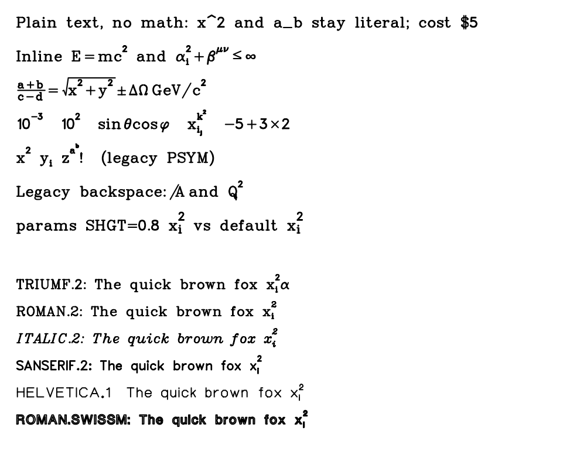

# strokefont

Use the TRIUMF / Physica stroke fonts (`vaxfont.dat`) in matplotlib.

The `strokefont` package reads the original binary font library and provides `StrokeText`, a
drop-in `matplotlib.text.Text` replacement that draws text as pen strokes. Strings use
matplotlib's own mathtext conventions (`$\alpha^2$`, `\frac`, `\sqrt`, ...), and a single call
(`strokefont.use()`) switches every tick label, axis label, title and legend of an ordinary
matplotlib script. The original PSYM control-character syntax is available as an optional
*legacy* mode. Output is real vector geometry on every backend (PNG, PDF, SVG, ...).



## Contents

| Path | Purpose |
|---|---|
| `src/strokefont/__init__.py` | Public API: `StrokeText`, `use`/`install`, `stroke_texts`, `get_font`, ... |
| `src/strokefont/_font.py` | Binary font-file reader and font cache |
| `src/strokefont/_symbols.py` | EBCDIC character/symbol mapping and PSYM control characters |
| `src/strokefont/_markup.py` | Mathtext-subset parser |
| `src/strokefont/_layout.py` | Glyph layout, line handling and legacy PSYM state machine |
| `src/strokefont/_text.py` | The `StrokeText` matplotlib artist |
| `src/strokefont/_install.py` | Matplotlib text-creation hooks (`use`, `install`, `stroke_texts`) |
| `examples/` | Runnable demos and the character-map generator |
| `tests/` | Pytest suite (functional tests skip without `vaxfont.dat`) |
| `docs/api.md` | Complete API reference for the public package interface |
| `docs/` | Rendered examples and the generated character map |
| `pyproject.toml` | Package metadata and build configuration |
| `src/strokefont/data/vaxfont.dat` | Optional local font library (git-ignored); bundled into private installs when present (see [Licensing](#licensing-and-provenance)) |

You also need `vaxfont.dat`, the font library. It is not part of this repository (see
[Licensing](#licensing-and-provenance)).

Requirements: Python 3.9+, NumPy, matplotlib (developed against 3.11).

## Historical background

**Sources.** The fonts and the routines that use them come from PHYSICA, the interactive
graphics and data-analysis environment developed at TRIUMF, the Canadian national particle and
nuclear physics laboratory on the UBC campus. The TRIUMF wiki says PHYSICA "was developed at
TRIUMF by Joe Chuma, Fred Jones and other[s]" (the sentence is truncated on the page). The text
below is drawn from the comments in two Fortran files of its `gplot` graphics library, `PFONT.F`
(font loading) and `PSYM.F` (text drawing), and from the wiki page.

**What the source code states**

- The design is "adapted from UBC PLOT (April 1981)", a plotting package from the University of
  British Columbia. The documentation of both routines was written by Richard T. Lee (TRIUMF,
  UBC), dated July 1981; `PSYM.F` describes itself as "PSYM package (Version 2.0), copyright 1988
  R. Lee", and says it "tries to simulate the 'PSYM' of UBC Computer Centre, which is written in
  ASSEMBLER", in a version meant to be more portable and easier to modify.
- The font data are indexed by EBCDIC codes: `PSYM.F` calls EBCDIC "the native code of the PSYM
  font structure" and converts ordinary ASCII strings with a routine named `ASCEBC`. This is why
  the glyph directory in `vaxfont.dat` is in EBCDIC order (`A` is 193, `a` is 129, digits are
  240-249).
- `PALPHA` was the original routine for choosing a character set. On 28 Nov 1991 F. W. Jones
  replaced it with `PFONT`, which selects a font by *name*, and kept `PALPHA` as a compatibility
  shell.
- Maintenance history recorded in the comments: spelling fixes to three font names (Alan
  Carruthers, 1983); a faster VMS reader (F. W. Jones, 1984); output of text into Graphics Editor
  drawing files and colour encoding (F. W. Jones, 1984-86); the `TRIUMF.OUTLINE` font (R. Lee,
  1988); an error exit for illegal ASCII (F. W. Jones, 1990); caching of up to five loaded fonts
  (C. Kost, 1991); and ports to HP-UX, AIX, g77 on Linux and Absoft (F. W. Jones and J. Chuma,
  1995-1998).
- The library is called `vaxfont.dat` because it was first a VAX/VMS file
  (`TRIUMF$FONTS:VAXFONT.DAT`). On Unix it is found through the `TRIUMF_FONTS` environment
  variable. In its original form it had three lines per font; the Unix version used here is a
  12000-byte-record direct-access file.
- The wiki gives some of the people and dates around PHYSICA: Joe Chuma joined TRIUMF in October
  1981 and retired in March 2008, and died on 5 August 2011. Extrema, a successor he helped
  develop, was released as open source in 2006. The wiki page itself does not mention the fonts,
  PSYM or UBC PLOT.

### References

- PHYSICA page on the TRIUMF DAQ wiki: <https://daq00.triumf.ca/DaqWiki/index.php/PHYSICA>
  (source repository, user guide and reference guide are linked from it).
- Legacy PHYSICA home page: <https://computing.triumf.ca/legacy/physica/> (suggested as a
  further history source; I could not retrieve it automatically, so nothing here is taken from it).
- PHYSICA source on Bitbucket: <https://bitbucket.org/ttriumfdaq/physica> (`PFONT.F` is
  `gplot/src/pfont.F` and `PSYM.F` is `gplot/src/psym.F`).
- PHYSICA manual: TRIUMF Computing Document TRI-CD-93-01, v1.3, J. L. Chuma, January 1998
  (the cover page is the source of the copyright notice quoted under
  [Licensing](#licensing-and-provenance); the rest of the manual is not used here).
- Hershey vector fonts, for comparison: A. V. Hershey, *Calligraphy for Computers*, U.S. Naval
  Weapons Laboratory, 1967.

## Installation

Install the package from the source tree:

```sh
pip install .
```

For development, use an editable install with the test tools:

```sh
pip install -e ".[dev]"
pytest
```

The font library is data, not code, so it is not included in the package. Tell `strokefont`
where it is, either in code or through the environment:

```python
import strokefont as sf
sf.set_font_file("/path/to/vaxfont.dat")
```

```sh
export TRIUMF_FONTS=/path/to/dir/containing/vaxfont.dat    # same variable the Fortran code used
```

`TRIUMF_FONTS` may name either the directory or the file itself.  Without an explicit path,
`strokefont` looks in `strokefont/data/vaxfont.dat`, then `fonts/vaxfont.dat`, then
`./vaxfont.dat`, mirroring `PFONT.F`.  `sf.get_font_file()` reports the path that will be used.

For a private installation that should not need `TRIUMF_FONTS` or `set_font_file()`, put the
font at `src/strokefont/data/vaxfont.dat` before installing:

```sh
mkdir -p src/strokefont/data
cp /path/to/vaxfont.dat src/strokefont/data/vaxfont.dat
pip install .
```

That file is git-ignored, but the build configuration includes it in the wheel and sdist when it
is present, so it lands at `strokefont/data/vaxfont.dat` inside the installation.  A
`vaxfont.dat` in the project root is also recognized for regular (non-editable) builds, but the
package-data location above works for editable installs too.  Builds still succeed when the file
is absent.  Do not commit or redistribute the font without permission (see
[Licensing](#licensing-and-provenance)).

## Examples

The scripts in `examples/` write their output to `docs/images/` (and `docs/charmap.pdf`):

| Script | Demonstrates |
|---|---|
| `examples/demo_install.py` | Drop-in use: an ordinary script (log axes, legend, colour bar) wrapped in `sf.use()` |
| `examples/demo.py` | Converting an existing figure with `stroke_texts` |
| `examples/demo_legend.py` | Legend with title, multi-line entries, Greek and sub/superscripts |
| `examples/demo_markup.py` | Mathtext subset, legacy mode, font parameters and several fonts |
| `examples/demo_charmap.py` | PDF character map of all 43 fonts, one page per font |

```sh
python examples/demo_install.py
python examples/demo.py
python examples/demo_legend.py
python examples/demo_markup.py
python examples/demo_charmap.py            # optional [vaxfont.dat] [charmap.pdf]
```

When the package is not installed, the examples fall back to importing it from `src/`.

## API reference

The complete public API — font loading, `StrokeText`, `install()`/`use()`, `stroke_texts()`,
symbol mapping and constants — is documented in [`docs/api.md`](docs/api.md).

## Usage

### 1. Drop-in: switch a whole script

```python
import matplotlib.pyplot as plt
import strokefont as sf

with sf.use("TRIUMF.2"):
    fig, ax = plt.subplots()
    ax.semilogy(x, y, label=r"$N \propto E^{-3/2}$")
    ax.set_xlabel(r"Energy $E$ (MeV)")
    ax.legend()
    fig.savefig("out.pdf")
```

`sf.use()` is a context manager; `sf.install("TRIUMF.2")` and `sf.uninstall()` do the same
without one. Inside it, everything matplotlib creates as `Text` becomes `StrokeText`: tick labels
(including `$\mathdefault{10^{n}}$` log ticks and offset text), axis labels, titles, `ax.text`,
`fig.text`, `suptitle`, legends and colour-bar labels. Annotations (`ax.annotate`) keep the normal
font. Only artists created *while installed* are affected.

Both functions accept the same global rendering defaults as `StrokeText`:

```python
sf.install("TRIUMF.2", linewidth=1.0, capheight=0.70, params={"SHGT": 0.8})

with sf.use("ROMAN.2", "plain", linewidth=0.8):
    ...
```

The signature is `install(font=None, markup=None, *, linewidth=None, capheight=None,
params=None)`; `use()` takes the same arguments. These values apply to artists created while
installed, and explicit arguments on an individual `StrokeText` still take precedence. `use()`
restores all previous defaults when the block exits.

### 2. A single object

`StrokeText` accepts the usual `Text` arguments: `fontsize`, `color`, `alpha`, `ha`, `va`,
`rotation`, `rotation_mode`, `multialignment`, `linespacing`, `transform`, `clip_on`, `zorder`,
`parse_math`, and so on. `fontfamily`, `fontweight` and `fontstyle` are ignored, since the font is
chosen by `font=`.

```python
ax.add_artist(sf.StrokeText(0.5, 0.5, r"decay $e^{-t/\tau}$", font="ROMAN.2", fontsize=14,
                            transform=ax.transAxes, ha="center", va="center"))
```

| Extra argument | Meaning | Default |
|---|---|---|
| `font` | One of the 43 font names (below) | `"TRIUMF.2"` (`StrokeText.default_font`) |
| `linewidth` | Pen width in points | `0.09 * fontsize` (`StrokeText.default_linewidth` if set) |
| `capheight` | Cap height as a fraction of `fontsize` | `0.72` (`StrokeText.default_capheight`) |
| `markup` | `"mathtext"`, `"legacy"` or `"plain"` | `"mathtext"` (`StrokeText.default_markup`) |
| `params` | PSALPH-style font parameter overrides ([below](#font-parameters)) | none (`StrokeText.default_params` if set) |

Sizes are normalised so that the capital-letter height is `capheight * fontsize` in every font,
so fonts look comparably sized even though their internal grids range from 16 to 246 units. Change
the weight of a font with `linewidth`.

### 3. Converting existing objects

```python
fig.canvas.draw()                    # make sure tick labels exist
sf.stroke_texts(fig, "TRIUMF.2")     # figure, axes, legend or single Text objects
```

Convert after the legend exists and after the ticks exist; ticks created later (for example by
zooming) use normal text. For that case use `sf.use()` instead.

### Markup: mathtext (default)

As in matplotlib, a string is plain text unless it contains an even number of unescaped `$`; the
parts between `$...$` are then math, and `\$` is a literal dollar sign. `parse_math=False` turns
parsing off. Inside math:

| Syntax | Result |
|---|---|
| `x^2`, `x^{ab}`, `x_i`, `x_{ab}`, `x_i^2` | super/subscripts (nest; both together are stacked) |
| `{...}` | grouping |
| `\alpha \Omega \pm \infty \le ...` | symbols from the table below, also Unicode `α ± ≤ ∞ °` |
| `\frac{a}{b}` | stacked fraction |
| `\sqrt{x}` | radical drawn over the argument |
| `\sin \cos \log ...` | function names, upright |
| `\mathrm{..} \mathit{..} \mathdefault{..} \text{..}` ... | accepted; the style is ignored (one font per object) |
| `\, \: \; \  \! \quad \qquad` | spaces |
| `\left( \right)` | accepted; delimiters are not stretched |
| `\{ \} \$ \% \& \# \_` | literal characters |

Operators (`= < > + - \pm \times ...`) get TeX-like spacing; spaces typed in math are ignored.
Script positions use the font's own `PSUP`, `PSUB` and `SHGT` header values, exactly as the
original `PSYM` routine did.

### Markup: legacy PSYM mode

`markup="legacy"` uses the original `PSYM` control characters (`PSYM.F`, ASCII input). There is no
`$` or `^` syntax in this mode; those characters are drawn literally.

| Constant | Character | Effect (original name) |
|---|---|---|
| `sf.UP` | `\t` (0x09) | superscript; at a higher level, the next higher superscript level |
| `sf.DOWN` | `\x01` | subscript; from a superscript, back down one level |
| `sf.UPSIZE` | `\x03` | up, and the size *always* changes (each level smaller) |
| `sf.DOWNSIZE` | `\x02` | down, and the size always changes |
| `sf.BACKSPACE` | `\b` (0x08) | one-character backspace (further if letterspacing is on) |
| | `\n` | carriage return (matplotlib line breaking is used) |

```python
sf.StrokeText(0, 0, "x" + sf.UP + "2" + sf.DOWN + " y" + sf.DOWN + "i" + sf.UP,
              markup="legacy", fontsize=14)
```

The state machine is a literal port of `PSYM.F`, including its asymmetries between the first and
higher script levels. Differences from the Fortran: size is set by `fontsize` and `capheight`,
not by `HEIGHT` and `SSCAL`; line spacing comes from matplotlib's `linespacing`; state is not
carried across line breaks. The old `PSMLEN` (string length) is `text.get_window_extent()`.

### Font parameters

`params=` takes the parameter names of the original `PSALPH` call, applied to this object
only (e.g. `params={"SHGT": 0.8, "LSPC": 4}`):

| Name | Parameter | Name | Parameter |
|---|---|---|---|
| `HSPC` | `HSPAC` fixed advance (letterspacing off) | `ANGL` | slant of the Y axis, degrees (-90 < `ANGL` < 90) |
| `VSPC` | `VSPAC` line spacing (not used; see `linespacing`) | `LTRS` | letterspacing on/off |
| `SUPS` | `PSUP` superscript reference point `(x, y)` | `REFP` | `REF` reference point `(x, y)` |
| `SUBS` | `PSUB` subscript reference point `(x, y)` | `LSPC` | `LSPAC` letterspacing constant |
| `SHGT` | script height / character height | `SCAL` | horizontal scale |
| `HSCL` | `SSCAL` height scale (no effect; see `capheight`) | | |

### Symbols

Greek letters and math symbols occupy EBCDIC slots that letters and digits do not use. They are
present in `TRIUMF.1` and `TRIUMF.2`, which I checked on the contact sheet; other fonts may
differ, so consult `docs/charmap.pdf` to see exactly what each font contains.

- Greek capitals: `\Gamma \Delta \Theta \Lambda \Xi \Upsilon \Phi \Psi \Omega \Sigma \Pi`
- Greek lower case: `\alpha \beta \gamma \delta \epsilon \zeta \eta \theta \vartheta \iota \kappa
  \lambda \mu \nu \xi \omicron \pi \rho \sigma \tau \upsilon \phi \varphi \chi \psi \omega
  \varepsilon`
- Relations and operators: `\le \ge \ne \approx \equiv \sim \ll \gg \propto \pm \mp \times \div
  \cdot \in \subset \supset \cup \cap \vee \wedge \oplus \perp \parallel \angle`
- Other: `\forall \exists \neg \therefore \infty \int \oint \partial \nabla \sqrt \aleph \hbar
  \dagger \degree \section \langle \rangle`
- Arrows: `\rightarrow \leftarrow \uparrow \downarrow \Rightarrow` (also `\to`)

The table is `strokefont.SYMBOLS` (name to EBCDIC code); extend it for other fonts.

### Fonts

`strokefont.FONT_NAMES` lists the 43 fonts in library order:

```
STANDARD  HELVETICA.1  GOTHIC.ENGLISH  ROMAN.3  ITALIC.3  GREEK.2A  ITALIC.2A  ROMAN.2A
SANSERIF.2  GREEK.1  SANSERIF.1  SCRIPT.1  GOTHIC.FRAKTUR  GOTHIC.ITALIAN  SCRIPT.2
ROMAN.2  ITALIC.2  GREEK.2  CYRILLIC.2  SANSERIF.CART  GREEK.CART  HIRAGANA  KATAKANA
KANJI1 ... KANJI5  OLDALPH  TRIUMF.1  TRIUMF.2  TSAN  ROMAN.FUTURA  ROMAN.SERIF
ROMAN.FASHON  ROMAN.LOGO1  ROMAN.SWISSL  ROMAN.SWISSM  ROMAN.SWISSB  SPECIAL  MATH
HEBREW  TRIUMF.OUTLINE
```

The names are those in `PFONT.F`; matching is case-insensitive. (The header stored inside the file
reads `MATHEMATICAL` for `MATH` and `TRMF:TRIUMF.1` / `TRMF:TRIUMF.2` for the two TRIUMF fonts.)

Only the Latin and TRIUMF-style fonts have the ASCII and symbol mapping that the markup relies
on. The Kanji, Kana, Hebrew and Cyrillic fonts load and draw, but their characters can only be
reached through their code slots, which the markup does not yet expose. Generate the complete map
with `python examples/demo_charmap.py vaxfont.dat docs/charmap.pdf`.

### Low-level access

```python
f = sf.get_font("ROMAN.2")             # optionally get_font(name, params={...})
width, verts, codes = f.glyph(193)     # EBCDIC code of "A"
# verts: (N, 2) grid coordinates; codes: matplotlib Path codes (MOVETO / LINETO)
f.grid, f.refx, f.refy, f.lspac, f.letterspacing, f.psup, f.psub, f.shgt, f.angl, f.defined
```

## The font file format

Each font occupies 24000 bytes (two 12000-byte records); the file is 43 x 24000 = 1,032,000
bytes. Fields as documented in `PFONT.F`:

| Offset | Content |
|---|---|
| 0-179 | ASCII header: `SIZE GRID HSPAC VSPAC PSUPx PSUPy PSUBx PSUBy` (8 x `I8`), `SHGT SCAL SSCAL ANGL` (4 x `F16.6`), `REFx REFy SWITCH LSPAC` (4 x `I8`), 4 blanks, 16-character name |
| 180-691 | Directory: 256 little-endian 16-bit offsets into the glyph data, indexed by EBCDIC code |
| 692- | Glyph data (`SIZE` bytes): per glyph `npoints`, `width`, then the points |

Points are on a `GRID x GRID` lattice with the origin at the lower left. For `GRID <= 16` each
point is one byte (high nibble x, low nibble y) and the pen-up marker is (15,15). For larger
grids each point is two bytes (x, y) and the marker is (255,255). Consecutive points are joined by
straight lines. A glyph's `width` byte is the x coordinate of its right edge.

Notes from `PSYM.F` and from reconstructing the format:

- Offset 0 is a blank glyph, and undefined characters point at it.
- A character is drawn with its `REF` point at the pen position. The pen then advances by
  `width + LSPAC` grid units if letterspacing is on (high bit of `SWITCH`), otherwise by
  `GRID + HSPAC`.
- A superscript (subscript) is drawn at `SHGT` times the size with its grid origin placed at the
  `PSUP` (`PSUB`) point of the preceding character's grid; leaving the script undoes the offset.
- The cap height is not stored; `strokefont` measures it from the glyph for `H`.

## Limitations

- Mathtext is a subset: one font per object (no `\mathbf`/`\mathit` switching), basic `\frac` and
  `\sqrt`, no stretchy delimiters, matrices or accents.
- `install()` redirects the creation sites in matplotlib's modules; it affects artists created
  afterwards, and modules imported later keep normal text. `Annotation` text keeps the normal font.
- No mixing of fonts within one string; create separate `StrokeText` objects instead.
- Stroke fonts have no outline, so `fontweight` has no meaning here; use `linewidth`. Very thin
  fonts at small sizes work best with `linewidth` raised a little.
- Some fonts are decorative or have overlapping strokes (for example `SCRIPT.2`).

## Licensing and provenance

This repository contains only the code that reads and draws the fonts; it does not include
`vaxfont.dat` or any of the original PHYSICA/`gplot` sources.

The Python code and documentation are released under the **BSD 3-Clause License**; see
[`LICENSE`](LICENSE). This licence does not apply to `vaxfont.dat`, which is not part of the
project and remains subject to whatever terms TRIUMF may set.

The only licensing statement found so far is on the cover page of the PHYSICA manual: a TRIUMF
Computing Document (4004 Wesbrook Mall, Vancouver, B.C., Canada V6T 2A3), by J. L. Chuma,
January 1998, document number TRI-CD-93-01, version 1.3, marked "Copyright
1993,1994,1995,1996,1997,1998 - All rights are reserved". That is a copyright notice on the
manual. It grants no permission, and it does not say what terms apply to the software or to the
font data, so the status of `vaxfont.dat` remains unknown (the wiki page states no licence
either). Until that is clarified, do not redistribute the font file or the Fortran sources with
this code, and contact TRIUMF before doing so.

The Python code in this repository is an independent reimplementation of the file format and
drawing rules described in the Fortran comments; it contains no text or data copied from those
sources, except the font names and the small symbol and character-code tables needed to read the
file. The package metadata declares `BSD-3-Clause`, and the wheel/sdist builds exclude
`vaxfont.dat` and the generated documentation images by default.
